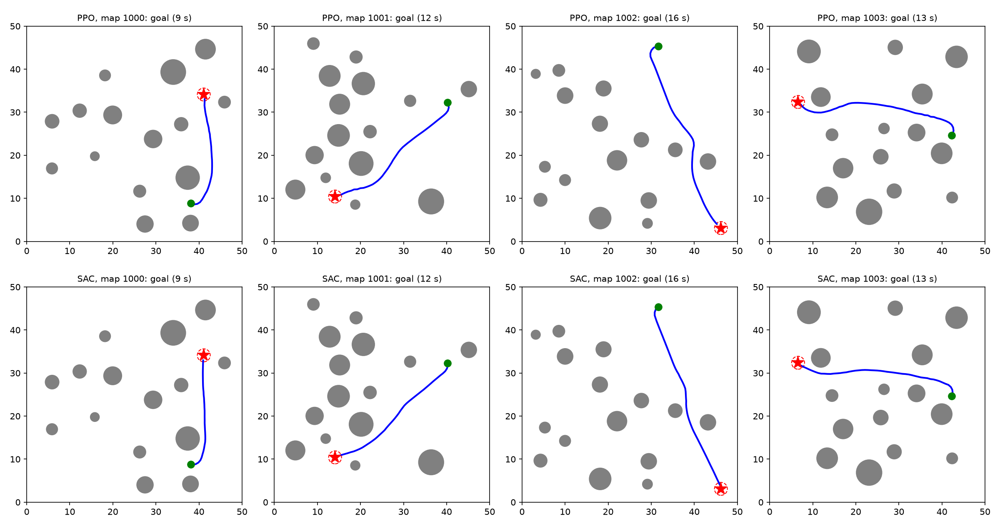
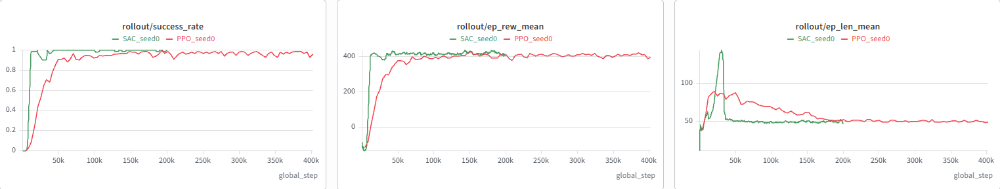
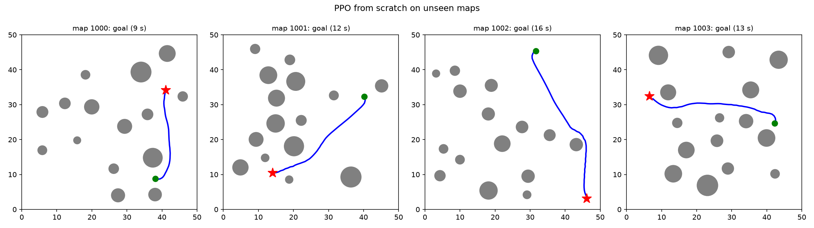

# UAV Navigation with Deep Reinforcement Learning

This project trains a UAV to reach a goal and avoid obstacles in a 50 m x 50 m map using deep reinforcement learning. The state and action spaces are continuous. I trained two algorithms, PPO and SAC, and compared them. I also implemented the environment and PPO from scratch with NumPy and PyTorch, without Gymnasium or Stable-Baselines3.



Trajectories of PPO (top) and SAC (bottom) on four test maps that were not used during training. The green dot is the start and the red star is the goal.

## Environment

The environment is written with Gymnasium in `uav_env.py`.

### Map

- 50 m x 50 m area with walls on all four sides
- 15 circular obstacles with radius between 1 and 3 m, placed at least 2 m apart
- A new random map is generated at the start of every episode
- Start and goal positions are random, at least 25 m apart, and placed in free space

### UAV model

The UAV moves in 2D at a fixed altitude. Its state is the position (x, y), heading angle, forward speed and turn rate. The time step is 0.25 s.

```
yaw = yaw + w * dt
x   = x + v * cos(yaw) * dt
y   = y + v * sin(yaw) * dt
```

### Observation

The observation has 43 values, all normalized to the range [-1, 1].

| Values | Description |
|---|---|
| 1 | Distance to the goal |
| 2 | Sine and cosine of the goal direction relative to the UAV heading |
| 2 | Current forward speed and turn rate |
| 2 | UAV position (x, y) |
| 36 | LiDAR ranges, one ray every 10 degrees, maximum range 10 m |

### Action

The action has 2 continuous values in [-1, 1], scaled as follows.

| Action | Range |
|---|---|
| Forward speed | 0 to 3 m/s |
| Turn rate | -1.5 to 1.5 rad/s |

### Reward

| Term | Value |
|---|---|
| Progress toward the goal | 10 x (distance reduced in this step) |
| Time penalty | -0.05 per step |
| Safety penalty when closer than 2 m to an obstacle | -0.5 x (2 - clearance) |
| Turning penalty | -0.05 x abs(turn action) |
| Goal reached (within 1.5 m) | +100, episode ends |
| Collision (closer than 0.5 m) | -100, episode ends |

An episode is truncated after 600 steps (150 s).

## Algorithms

Both algorithms use Stable-Baselines3 with PyTorch. The actor and critic networks are MLPs with two hidden layers of 256 units. PPO uses Tanh activation (the Stable-Baselines3 default for PPO) and SAC uses ReLU. Training was logged with Weights & Biases.

| Parameter | PPO | SAC |
|---|---|---|
| Training steps | 400,000 | 200,000 |
| Parallel environments | 4 | 1 |
| Learning rate | 0.0003 | 0.0003 |
| Discount factor (gamma) | 0.99 | 0.99 |
| Batch size | 256 | 256 |
| Steps per update | 1024 per environment | 1 |
| Epochs per update | 10 | - |
| GAE lambda | 0.95 | - |
| Clip range | 0.2 | - |
| Replay buffer size | - | 300,000 |
| Learning starts | - | 5,000 |
| Target update rate (tau) | - | 0.005 |
| Entropy coefficient | - | automatic |

## Results

### Training



| | PPO | SAC |
|---|---|---|
| Steps to reach about 90% success | about 50,000 | about 8,000 |
| Final success rate during training | about 96% | about 100% |
| Training time on CPU | 10 min | 75 min |
| Training speed | about 680 steps/s | about 44 steps/s |

SAC needed far fewer environment steps to learn the task, but it was slower in real time because it updates the networks after every step.

### Evaluation

Both trained policies were tested on 200 new maps using deterministic actions. A simple baseline that steers straight to the goal without using the LiDAR is included for comparison. The 25 obstacle setting was not used during training.

| Policy | Success (15 obstacles) | Collision (15 obstacles) | Success (25 obstacles) | Collision (25 obstacles) | Flight time | Path ratio |
|---|---|---|---|---|---|---|
| Simple baseline | 25.5% | 74.5% | 8.5% | 91.5% | 21.6 s | 1.00 |
| PPO | 97.5% | 2.5% | 91.5% | 8.5% | 12.6 s | 1.07 |
| SAC | 99.0% | 1.0% | 99.5% | 0.5% | 12.2 s | 1.01 |

Path ratio is the flown distance divided by the straight line distance from start to goal.

Both policies learned to use the LiDAR to avoid obstacles and performed much better than the baseline. On the denser maps, SAC kept its performance while PPO dropped to 91.5%. SAC also flew more direct paths.

## PPO from scratch (NumPy and PyTorch)

The `scratch/` folder contains a second version that does not use Gymnasium or Stable-Baselines3. The environment is written with NumPy only, and PPO is implemented directly in PyTorch.

The NumPy environment gives exactly the same observations and rewards as the Gymnasium version for the same seed and actions, so the results can be compared directly.

### Implementation

- Actor: MLP 43 -> 256 -> 256 -> 2 with Tanh, outputs the mean of a Gaussian. The standard deviation is a separate learned parameter that starts at 1.
- Critic: MLP 43 -> 256 -> 256 -> 1 with Tanh, outputs the state value.
- Orthogonal weight initialization, with a small gain (0.01) on the actor output so the first actions are centered at zero.
- Rollouts from 4 environments, 1024 steps each (4096 steps per update).
- Advantages with GAE. When an episode is cut by the time limit, the value of the next state is added to the reward, so a time out is not treated like a crash.
- Clipped PPO objective, 10 epochs over the rollout in minibatches of 256, advantages normalized per minibatch.
- Separate Adam optimizers for the actor and the critic, gradient clipping at 0.5.
- Logged to W&B: success rate, policy and value loss, approximate KL, clip fraction, explained variance and action std.

| Parameter | Value |
|---|---|
| Training steps | 400,000 |
| Parallel environments | 4 |
| Steps per update | 1024 per environment |
| Epochs per update | 10 |
| Minibatch size | 256 |
| Learning rate | 0.0003 |
| Discount factor (gamma) | 0.99 |
| GAE lambda | 0.95 |
| Clip range | 0.2 |
| Max gradient norm | 0.5 |
| Entropy coefficient | 0 |

### Results

Evaluated on the same 200 test maps with deterministic actions.

| Policy | Success (15 obstacles) | Collision (15 obstacles) | Success (25 obstacles) | Collision (25 obstacles) | Flight time | Path ratio |
|---|---|---|---|---|---|---|
| PPO from scratch | 97.5% | 2.5% | 97.0% | 3.0% | 12.2 s | 1.04 |
| PPO (Stable-Baselines3) | 97.5% | 2.5% | 91.5% | 8.5% | 12.6 s | 1.07 |



The from-scratch version reaches the same success rate as Stable-Baselines3 on the training setting, which validates the implementation. It reached about 90% training success after about 30,000 steps. It also did better on the denser 25 obstacle maps, but each version was trained with one seed only, so more seeds are needed before saying it is better.

### Files

```
scratch/
    env_np.py           environment in pure NumPy
    ppo.py              actor, critic, rollout buffer, GAE and PPO update
    train_ppo.py        training loop with W&B logging
    evaluate_np.py      evaluation on 200 test maps
    test_env_np.py      checks the NumPy environment against the Gymnasium one
    test_networks.py    checks network shapes and outputs
    test_rollout.py     checks rollout collection
    test_gae.py         checks GAE on a small hand example
```

### Usage

```
cd scratch
python train_ppo.py --steps 400000 --seed 0
python evaluate_np.py
```

## Project Structure

```
uav_drl/
    uav_env.py      Gymnasium environment
    check.py        environment check with check_env
    test_env.py     visual test with random and simple policies
    train.py        PPO and SAC training
    evaluate.py     evaluation on 200 test maps
    models/         trained models
    figures/        figures used in this README
    scratch/        environment and PPO implemented from scratch
```

## Installation

```
python -m venv .venv
.venv\Scripts\activate
pip install torch --index-url https://download.pytorch.org/whl/cpu
pip install gymnasium stable-baselines3 matplotlib numpy wandb tensorboard
```

On Linux or Mac, activate the environment with `source .venv/bin/activate`.

## Usage

Check the environment:

```
python check.py
```

Train the models:

```
python train.py --algo PPO --steps 400000
python train.py --algo SAC --steps 200000
```

Evaluate both models:

```
python evaluate.py
```

## Author

Rumal Boidya
M.Sc. student, Hosei University